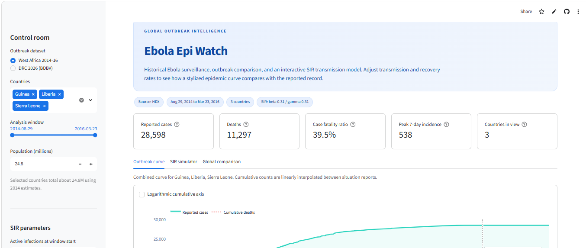

# Ebola Epi Watch: A Public Health Epidemiological Dashboard

Live Dashboard: [Ebola Epi Watch · Streamlit](https://chijiokeuhegwu-ebola-epi-app-x8mtnh.streamlit.app/)



## 1. Project Title & Overview

### Ebola Epi Watch: From Reported Cases to Actionable Scenarios

**Ebola Epi Watch** is a public health dashboard for exploring Ebola outbreak trends and testing transmission scenarios in one place. The ingestion pipeline checks the **WHO Global Health Observatory (GHO) API** and pulls operational case, death, and health-zone data from public humanitarian sources distributed through the **Humanitarian Data Exchange (HDX)**. The dashboard pairs those cleaned historical curves with an interactive **SIR model**, so users can change transmission and recovery rates and immediately see how an outbreak could unfold.

The project is designed for public health analysts, emergency responders, students, and anyone who wants a clear, hands-on view of outbreak dynamics without needing to write code.

## 2. Core Project Aims

- **Bring authoritative data into one place.** Query public health APIs and humanitarian CSV streams, download the latest resources, and retain a local cache for reliability.
- **Clean data on demand.** Parse dates, remove duplicate reports, reconcile revisions, build daily time series, and calculate cumulative and new cases and deaths.
- **Support real public health decisions.** Give health officials and analysts a safe environment to simulate how changes in transmission and recovery rates could affect an outbreak.
- **Make the model transparent.** Show the actual reported curve next to the modeled curve, report the assumptions, and expose every input through clear sidebar controls.
- **Compare outbreaks fairly.** Align outbreaks by days since the first reported case so that epidemics of different sizes and eras can be viewed side by side.
- **Keep the work reproducible.** Store raw source files, normalized outputs, ingestion metadata, and a one-command pipeline so results can be checked and repeated.

## 3. Key Features & Takeaways

### What you can do with the dashboard

- **Switch between outbreaks.** Explore the **West Africa 2014-16** Ebola outbreak or the **DRC 2026 (BDBV)** outbreak.
- **Filter to the population you care about.** Select countries, adjust the analysis window, or focus on the latest wave of cases.
- **Tune the SIR model in real time.** Use the sidebar sliders to change:
  - **beta** (transmission rate, per day)
  - **gamma** (recovery rate, per day)
  - **Population**, **active infections at the model start**, and the **projection horizon**
- **Auto-fit the model to the data.** Click **Auto-fit beta and gamma** to let SciPy search for the parameters that best match the selected reported curve.
- **Compare reality with the model.** View the reported cumulative curve against the SIR cumulative curve, and compare daily reported cases with modeled new infections.
- **Read the epidemic at a glance.** KPI cards show cumulative cases, deaths, case fatality ratio, peak 7-day incidence, and affected countries or health zones.
- **Explore the model's internal state.** Inspect modeled active infections and the SIR phase plane.
- **Compare outbreaks.** Use the **Global comparison** tab to view cumulative trajectories by days since first report, compare cases, deaths, and case fatality ratios, and switch to a logarithmic scale.
- **Download the evidence.** Export the aggregated analysis window as a CSV and review data provenance inside the app.

### Quick guide to the SIR controls

| Control | What it changes | How to read it |
|---|---|---|
| **beta** | How quickly susceptible people become infectious | Higher beta means more transmission per day. |
| **gamma** | How quickly infectious people recover | Higher gamma means a shorter infectious period, about **1 / gamma** days. |
| **R0** | The basic reproduction number, **beta / gamma** | Above 1, the model tends to grow; below 1, it tends to decline. |
| **Active infections at start** | The number of infectious people when the model begins | A larger starting value can produce a faster early rise in cumulative cases. |
| **Projection horizon** | How far beyond the observed data the model runs | Extend it to explore possible future trajectories. |

### The model at a glance

The SIR model divides a closed population (**N**) into three groups:

- **S** — susceptible people
- **I** — infectious people
- **R** — recovered people

The model is solved with SciPy:

```text
dS/dt = -beta * S * I / N
dI/dt =  beta * S * I / N - gamma * I
dR/dt =  gamma * I
```

The app also reports the **effective reproduction number at the model start**, the **herd immunity threshold**, the **peak number of active infections**, and the **modeled attack rate**.

### What the model can teach us

- **Small parameter changes can have large effects.** Raising beta or lowering gamma can turn a manageable outbreak into a rapidly growing one.
- **Recovery speed matters.** A shorter infectious period lowers the time each person has to pass the infection on.
- **R0 is a starting point, not the whole story.** The effective reproduction number falls as the susceptible population shrinks.
- **Real outbreaks are not perfectly mixed.** Interventions, behavior change, reporting delays, and population structure all affect the observed curve.

> **Important:** The SIR output is a **scenario tool**, not an official forecast. It uses a closed population, homogeneous mixing, constant parameters, and no separate death compartment. Reported outbreak data also contain revisions and reporting delays. Use the model to explore assumptions, not to predict exact future case counts.

## 4. Project Architecture & File Structure

This repository uses a compact, flat layout so the data pipeline and the dashboard are easy to find.

```text
Ebola-Epi/
├── app.py                         # Streamlit dashboard entry point
├── epi_model.py                   # SIR simulation, calibration, and metrics
├── ingest.py                      # API ingestion, download, cleaning, and export
├── requirements.txt               # Python dependencies
├── README.md                      # Project documentation
├── .streamlit/
│   └── config.toml                # Theme and server configuration
└── data/
    ├── raw/
    │   ├── ebola_data_db_format.csv
    │   └── drc_ebola_cases_consolidated.csv
    ├── ebola_west_africa.csv      # Normalized country time series
    ├── ebola_drc_2026.csv         # Normalized national time series
    ├── ebola_drc_subnational.csv  # Health-zone snapshot
    └── ingestion_metadata.json    # Source URLs, dates, row counts, and status
```

| File or folder | Purpose |
|---|---|
| **app.py** | Builds the dashboard, charts, filters, sidebar controls, and downloads. |
| **epi_model.py** | Solves the SIR differential equations and calibrates beta and gamma with SciPy. |
| **ingest.py** | Queries the HDX package API, downloads source CSVs, cleans them, and writes normalized files plus metadata. |
| **data/raw/** | Local cache of the original downloaded files. Kept so the app still works if the network is unavailable. |
| **data/** | Clean, analysis-ready tables used by the dashboard. |
| **.streamlit/config.toml** | Dark theme, server port, and headless defaults. |
| **requirements.txt** | Installable list of Python packages. |

> **Path note:** This repository keeps the dashboard entry point at the project root (`app.py`). If you move it into a `dashboards/` folder, the equivalent command is `streamlit run dashboards/app.py`.

## 5. Tech Stack & Dependencies

| Tool | Role in the project |
|---|---|
| **Streamlit** | Builds the interactive web application and sidebar controls. |
| **Pandas** | Ingests, cleans, reshapes, and aggregates the outbreak data. |
| **Plotly** | Renders interactive line charts, bar charts, health-zone charts, and the SIR phase plane. |
| **SciPy** | Solves the SIR ordinary differential equations and performs least-squares calibration. |
| **Requests + urllib3** | Handles resilient API queries and downloads with retries and timeouts. |
| **Python 3.10+** | Runtime environment. The project was tested on Python 3.12. |

Data services used by the pipeline:

- **Humanitarian Data Exchange (HDX) CKAN API** for dataset discovery, metadata, and CSV resources.
- **WHO Global Health Observatory (GHO) API** for an Ebola indicator check. At the time of the latest ingestion run, GHO returned no Ebola-specific case or death indicators, so the dashboard uses the WHO situation-report series distributed through HDX.

All Python dependencies are listed in `requirements.txt`:

```text
pandas>=2.2
streamlit>=1.40
plotly>=5.24
scipy>=1.13
requests>=2.31
```

## 6. How to Set Up and Run the Project

### Prerequisites

- **Python 3.10 or newer**
- **Git**
- An internet connection for the first data refresh (the repository also includes normalized data, so the dashboard can run offline)

### Step 1: Clone the repository

```bash
git clone https://github.com/ChijiokeUhegwu/Ebola-Epi
cd Ebola-Epi 
```

### Step 2: Create and activate a virtual environment

**Windows PowerShell**

```powershell
python -m venv .venv
.\.venv\Scripts\Activate.ps1
```

**macOS or Linux**

```bash
python3 -m venv .venv
source .venv/bin/activate
```

### Step 3: Install dependencies

```bash
python -m pip install --upgrade pip
pip install -r requirements.txt
```

The core packages can also be installed directly:

```bash
pip install pandas streamlit plotly scipy requests
```

### Step 4: Refresh the data (optional)

The dashboard ships with normalized data. To pull the latest source files and rebuild the cleaned tables, run:

```bash
python ingest.py
```

Useful ingestion options:

```bash
python ingest.py --refresh    # Force fresh downloads
python ingest.py --offline    # Rebuild from cached raw files only
```

The pipeline writes normalized CSVs and `data/ingestion_metadata.json`. If a download fails, it falls back to the cached raw file when one is available.

### Step 5: Start the dashboard

From the project root:

```bash
streamlit run app.py
```

The app opens at:

```text
http://localhost:8501
```

> If you reorganize the dashboard under a `dashboards/` folder, start it with `streamlit run dashboards/app.py`.

### Step 6: Explore the app

1. Choose an outbreak in the sidebar.
2. Select countries or adjust the analysis window.
3. Set **beta**, **gamma**, population, and the starting number of active infections.
4. Click **Auto-fit beta and gamma** to calibrate the model to the visible curve.
5. Compare the reported and modeled curves in the **SIR simulator** tab.
6. Open **Global comparison** to view both outbreaks on a shared time axis.

### Troubleshooting

- **Data files are missing:** Run `python ingest.py` from the project root, then reload the app.
- **Port 8501 is already in use:** Start on another port with `streamlit run app.py --server.port 8502`.
- **A download fails:** Keep the cached files in `data/raw/` and rerun `python ingest.py --offline`.
- **The model looks unstable:** Use a longer analysis window, adjust the starting active infections, or click **Auto-fit beta and gamma** before changing parameters manually.

## 7. Repository & Deployment Links

| Resource | Link |
|---|---|
| **GitHub Repository** | `https://github.com/ChijiokeUhegwu/Ebola-Epi` |
| **Live Dashboard** | `https://chijiokeuhegwu-ebola-epi-app-x8mtnh.streamlit.app/` |

### Data sources and attribution

- **West Africa 2014-16:** [Number of Ebola Cases and Deaths in Affected Countries](https://data.humdata.org/dataset/ebola-cases-2014) — WHO situation reports distributed through HDX.
- **DRC 2026 (BDBV):** [République démocratique du Congo : Cas et Décès d'Ebola](https://data.humdata.org/dataset/republique-democratique-du-congo-cas-et-de-deces-d-ebola) — INRB-UMIE surveillance streams distributed by OCHA DRC through HDX.
- **WHO Global Health Observatory API:** [https://ghoapi.azureedge.net/api](https://ghoapi.azureedge.net/api) — used for an Ebola indicator check at ingestion time.

Data snapshots currently bundled with the project:

- **West Africa:** 2014-08-29 to 2016-03-23
- **DRC:** 2026-05-14 to 2026-10-18

Please retain the source attribution when reusing or redeploying the dashboard.

---

**Ebola Epi Watch** is a teaching and scenario-planning tool built by Chijioke C. Uhegwu. It supports exploration and discussion; it does not replace official surveillance, field epidemiology, or clinical guidance. All rights reserved. 
